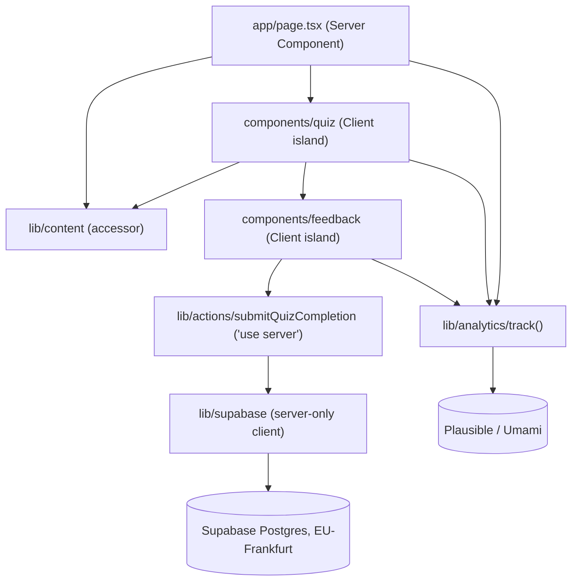
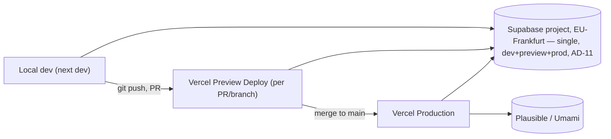

# Architecture Spine — Deer — Landing + Quiz di Assaggio

## Design Paradigm

**Server-first Islands.** The landing route is a tree of Server Components — no client JS ships for anything that isn't interactive. Interactivity is isolated into two Client Component islands (quiz flow, final-screen feedback form). The only path from client to backend is a Server Action, which is the sole place Supabase credentials exist. Static content and analytics both go through single shared modules, not ad-hoc per-component access, so the two islands and the server tree can't drift on how they read questions or fire events.

Layers map to directories:

- **Presentation (Server Components)** → `app/`, `components/landing/`
- **Interactive islands (Client Components)** → `components/quiz/`, `components/feedback/`
- **Mutation boundary (Server Actions)** → `lib/actions/`
- **Content access** → `lib/content/`
- **External service clients** → `lib/supabase/` (server-only), `lib/analytics/`

## Invariants & Rules

### AD-1 — Stack and hosting fixed [ADOPTED]

- **Binds:** all
- **Prevents:** re-deciding framework/hosting/DB per feature; drift toward a different stack mid-slice.
- **Rule:** Next.js (App Router) + TypeScript + Tailwind CSS on Vercel; Supabase (Postgres, EU-Frankfurt) for the one backend table this slice needs; cookieless analytics (Plausible or Umami, final pick is OQ-4); Stripe and a Refine backoffice are out of scope for this slice.

### AD-2 — No mid-quiz server persistence; exactly one completion write [ADOPTED]

- **Binds:** FR-7, FR-11
- **Prevents:** a per-question save call being added later "for safety," which would contradict FR-7's refresh-resets-to-Q1 behavior and create partial-quiz records.
- **Rule:** No network write happens between question 1 and the final screen. Exactly one write happens, on quiz completion, carrying score + optional feedback + optional email + timestamp.

### AD-3 — Static quiz content lives in the repo, not the DB [ADOPTED]

- **Binds:** FR-5, FR-6, FR-8, FR-11
- **Prevents:** a component fetching questions from Supabase before the DB migration is a real, planned decision.
- **Rule:** The 10 questions + mnemonics are versioned data files in the repo. No question/mnemonic table exists in Supabase this slice.

### AD-4 — Design tokens and components are fixed by DESIGN.md [ADOPTED]

- **Binds:** all UI
- **Prevents:** this spine re-deciding colors, type, spacing, or component shapes that DESIGN.md already owns.
- **Rule:** DESIGN.md's component inventory (`quiz-card`, `answer-option`, `mnemo-box`, `category-tag`, `button-primary`, etc.) is reused by name wherever that visual role recurs (e.g. the same `quiz-card` component backs FR-4's static preview, FR-5's real question, and FR-2's "Con Deer" column) — never re-implemented per surface.

### AD-5 — FR-11 write goes through a Server Action; Supabase credentials never reach the browser

- **Binds:** FR-10, FR-11, NFR-3
- **Prevents:** an anon Supabase key shipping in the client bundle; a second, undocumented write path bypassing validation.
- **Rule:** The final-screen form submits to a single Server Action (`lib/actions/submitQuizCompletion.ts`, `'use server'`) that validates input server-side and performs the Supabase insert using the project's server-side secret key (legacy `service_role` JWT or the newer `sb_secret_...` format — Supabase issues one or the other depending on when the project is created; confirm the actual format at provisioning, OQ-5), read only from server-side env, never a `NEXT_PUBLIC_`-prefixed var. RLS on the completions table denies all access except this key. Called via `useActionState` + a `<form action>` (React/Next.js standard form-action pattern) — not an imperative `fetch`/typed-object call from an event handler — so every caller of this action gets the same pending/error/success plumbing.
- **Score integrity:** the action receives the raw list of given answers (question id → selected option), not a pre-computed `score` — the server recomputes the score from `lib/content` before writing, so a tampered client can't submit a false score.
- **Timestamp:** `completedAt` is stamped server-side inside the action (`new Date().toISOString()`), never accepted from the client.

### AD-6 — Quiz content reached only through one accessor module

- **Binds:** FR-4, FR-5, FR-8
- **Prevents:** N call sites (landing preview, quiz flow, results summary) each parsing the raw content file differently, each needing a separate edit when content moves to Supabase later.
- **Rule:** All reads of question/mnemonic content go through `lib/content/index.ts` (`getQuestions()`, `getPreviewQuestion()`). No component imports the raw data file directly.

### AD-7 — Quiz flow is one route, state held in memory

- **Binds:** FR-5, FR-6, FR-7
- **Prevents:** a per-question route (`/quiz/[step]`) that would let a refresh resurrect mid-quiz progress via the URL, contradicting FR-7.
- **Rule:** The quiz (question index, given answers, revealed mnemonics) lives entirely in `useState`/`useReducer` inside the `components/quiz/` island. No route segment encodes quiz step.

### AD-8 — Server Components by default; client boundary drawn only around interactive islands

- **Binds:** all UI
- **Prevents:** `'use client'` at the top of the whole page, which would ship the entire landing tree as client JS for the sake of two small interactive pieces.
- **Rule:** `app/page.tsx` and everything under `components/landing/` stay Server Components. `'use client'` appears only in `components/quiz/` and `components/feedback/`.

### AD-9 — Analytics events fired only through one wrapper

- **Binds:** FR-12
- **Prevents:** the landing page and the quiz island independently choosing different names/props for what should be the same event.
- **Rule:** All tracking calls go through `lib/analytics/track.ts`, against a fixed event list in `lib/analytics/events.ts` (e.g. `visit_landing`, `quiz_started`, `quiz_completed`). No component calls the Plausible/Umami SDK directly. `quiz_completed` fires only after the Server Action returns `{ ok: true }` — never optimistically on submit — so the event's reliability matches what's actually in Supabase (SM-1 depends on this).

### AD-10 — Design tokens wired as Tailwind theme, not CSS variables

- **Binds:** all UI
- **Prevents:** two parallel token systems (Tailwind config values vs. hand-written CSS custom properties) drifting apart as components are added.
- **Rule:** DESIGN.md's colors/type/spacing/radii are registered under `theme.extend` in the Tailwind v4 config and consumed as ordinary utility classes. No `var(--token)` arbitrary-value usage for values already in the theme.

### AD-11 — Single Supabase project, no dev/prod split this slice

- **Binds:** FR-11, deployment
- **Prevents:** provisioning a second project now for a single write-only, low-risk table — cost/setup not justified at this stage.
- **Rule:** One Supabase project (EU-Frankfurt) serves local dev, Vercel Preview deploys, and production alike. Accepted trade-off: Preview-deploy submissions land in the same table as production completions (low volume, low risk for an MVP validation slice) — revisit if Preview traffic starts skewing SM-1/SM-2. Revisit the single-project split itself when the full product (auth, real question bank) lands.

**Dependency direction:**



## Consistency Conventions

| Concern | Convention |
| --- | --- |
| Naming (entities, files, interfaces, events) | Components PascalCase, files kebab-case. Analytics event names snake_case, defined once in `lib/analytics/events.ts`. Question/mnemonic records keyed by a stable numeric `id` (1–10). Supabase table `quiz_completions`, columns `snake_case` (Postgres convention); the TS record stays `camelCase` and is mapped to snake_case only inside `lib/supabase/`, never elsewhere. |
| Data & formats (ids, dates, error shapes, envelopes) | Server Action input (client → action): `{ answers: { questionId: number, selectedOptionId: string }[], feedback?: number, email?: string }` — `feedback` coerced from FormData string to number via the zod schema (`z.coerce.number()`), not passed as a JS number from a typed call. Score is derived server-side from `answers`, not accepted as input (AD-5). Server Action output: `{ ok: true }` or `{ ok: false, error: string }` — never throws to the client for expected validation failures. Stored completion record: `{ score: number, feedback?: 1\|2\|3\|4\|5, email?: string, completedAt: ISO 8601 string }`, `completedAt` server-stamped (AD-5). |
| State & cross-cutting (mutation, errors, logging, config, auth) | `lib/supabase/` and `lib/actions/` are server-only (import `server-only` package) — a build error if a Client Component imports them; this is enforced at build time. `AD-6`/`AD-9`/`AD-10` (content accessor, analytics wrapper, Tailwind theme) have no build-time enforcement — code review is the gate; an ESLint import-restriction rule is a candidate addition if drift shows up in review, not decided this slice. No auth this slice. Secret Supabase key read from server env only (name per AD-5); no Supabase env var carries the `NEXT_PUBLIC_` prefix. Validation library is Zod **v4** (`^4.4.3`) — its error-customization API and generics differ from v3; write schemas against v4 syntax, not v3 patterns from training data. |

## Stack

| Name | Version |
| --- | --- |
| Next.js (App Router) | 16.2.12 |
| React | 19.2.4 |
| TypeScript | ^5 |
| Tailwind CSS | ^4 |
| @supabase/supabase-js | ^2.111.0 |
| zod (Server Action input validation) | ^4.4.3 |
| server-only | ^0.0.1 |
| Vercel | hosting platform, no pinned version |
| Supabase project | Postgres, EU-Frankfurt region |

## Structural Seed

```text
app/
  layout.tsx          # root layout, fonts (Lexend, Inter)
  page.tsx             # landing route — Server Component
  globals.css          # Tailwind entry
components/
  landing/             # hero, comparison section, preview card, footer — Server Components
  quiz/                 # QuizFlow client island: question card, answer options, mnemo box, progress
  feedback/             # FeedbackForm client island: star rating + email field
  ui/                   # shared primitives per DESIGN.md (button-primary, chip, category-tag, quiz-card)
lib/
  content/              # questions.ts (static data) + index.ts (getQuestions/getPreviewQuestion)
  actions/              # submitQuizCompletion.ts ('use server')
  supabase/             # server-only Supabase client (service-role key)
  analytics/            # track.ts + events.ts (fixed event names, FR-12)
public/
```

**Deployment & environments:**



Single Vercel project, platform-default preview-per-PR and production-on-`main` — no custom CI/CD pipeline needed for this slice.

## Capability → Architecture Map

| Capability / Area | Lives in | Governed by |
| --- | --- | --- |
| FR-1, FR-2, FR-3 (hero, comparison, footer) | `components/landing/` | AD-4, AD-8 |
| FR-4 (quiz preview card) | `components/landing/`, `lib/content/` | AD-3, AD-4, AD-6 |
| FR-5, FR-6, FR-7 (quiz flow) | `components/quiz/`, `lib/content/` | AD-2, AD-3, AD-6, AD-7, AD-8 |
| FR-8 (result + mnemonic recap) | `components/quiz/` (final state) | AD-6, AD-7 |
| FR-9, FR-10 (feedback + email) | `components/feedback/` | AD-8 |
| FR-11 (completion event write) | `lib/actions/`, `lib/supabase/` | AD-2, AD-5, AD-11 |
| FR-12 (cookieless analytics) | `lib/analytics/` | AD-9 |
| NFR-1 (accessibility, no color-only state) | `components/ui/` (`answer-option-correct`) | AD-4 (DESIGN.md do/don't) |
| NFR-3 (EU data residency) | `lib/supabase/` | AD-1, AD-5, AD-11 |
| NFR-2 (mobile-first performance) | `components/` (Server-Component-default keeps bundle small, AD-8) | AD-8; no quantitative budget — see Deferred |

## Deferred

- **OQ-1** — real question/mnemonic content; placeholder data ships this slice, PO replaces before launch.
- **OQ-2** — final logo; `logo-mark` placeholder per DESIGN.md until then.
- **OQ-3** — legal copy (Privacy/Termini) and the GDPR consent microcopy next to the email field; candidate Iubenda, not activated yet.
- **OQ-4** — Plausible vs. Umami final pick and account setup; either fits behind the `lib/analytics/track()` wrapper (AD-9) without changing call sites.
- **OQ-5** — Supabase project provisioning and account ownership (must be PO, per project-context.md).
- **OQ-6** — domain/DNS; blocks public launch, not development (Vercel preview URLs work without it).
- **Moving question/mnemonic content to Supabase** — explicitly future (PRD FR-11 note); AD-6's accessor module is the seam that absorbs this without touching `components/`.
- **Auth / user accounts / cross-device progress** — explicit PRD non-goal for this slice; no seam reserved for it yet.
- **Rate-limiting / spam protection on the Server Action** — not decided this slice; AD-5's Server Action boundary is the natural place to add it later without a structural change.
- **NFR-2 quantitative performance budget** — no Lighthouse/Core Web Vitals target set (PRD assumption, explicitly left for architecture to define "if needed"). Not fixed here: AD-8's Server-Component-default keeps the bundle small by construction, judged sufficient for a 4-page MVP slice without a formal budget. Revisit if real-world mobile performance complaints surface.
- **Error monitoring / observability** — no error-tracking tool (e.g. Sentry) or logging strategy decided for Server Action failures. Acceptable gap for this slice's traffic/risk level; revisit before the full product ships.
- **Vercel/Supabase env var and secrets management workflow** — which env vars live in Vercel project settings vs. `.env.local`, who has access — not decided; PO owns all accounts per project-context.md, mechanics to be worked out at provisioning (OQ-5).
