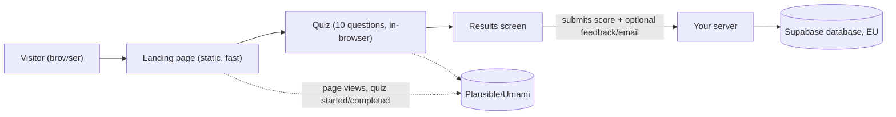
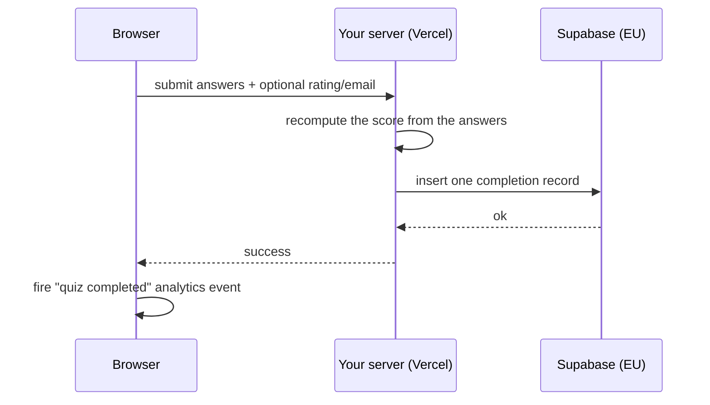

# Deer — Landing + Quiz di Assaggio — Solution Design

This document walks through how the first public slice of Deer gets built, in plain language. It's a companion to `ARCHITECTURE-SPINE.md`, which is the terse, authoritative version a developer or coding agent works from — this document exists to explain the *why* behind that spine's decisions, for anyone reviewing the approach before implementation starts.

## What we're building

A landing page (hero, "why this isn't just another quiz" comparison, footer) plus a 10-question quiz that anyone can try without creating an account. After the last question, a results screen shows the score, recaps all 10 mnemonics, and offers an optional star rating and email signup. Everything is defined in `prd-deer-2026-08-01/prd.md`; this document covers only how it gets built, not what it does.

## The shape of the system

Three things worth understanding about this shape:

**The landing page is essentially a static page.** Nothing about the hero, the comparison section, or the footer needs to react to anything — so it's built and served the "boring" way: rendered once on the server, shipped as plain HTML. That keeps it fast, especially on mobile, without any special performance work.

**The quiz lives entirely in the visitor's browser until the very end.** Answering questions, seeing the score climb, revealing mnemonics — none of that talks to a server. This matches a specific requirement: if someone refreshes mid-quiz, they should land back on question 1, with nothing saved. Building it as one page holding everything in memory makes that the natural behavior, not something we have to work to enforce.

**Exactly one thing gets saved, at the very end.** When the quiz finishes, one record goes to the database: the score, the star rating if given, the email if given, and when it happened. Nothing is saved for someone who abandons the quiz partway — that's a deliberate requirement (§FR-7 in the PRD), not an oversight.

## How a completed quiz reaches the database

This is the one place in the system that talks to real infrastructure, so it's worth walking through carefully.

Two choices here matter enough to call out:

- **The database credentials never reach the browser.** Only your server holds the key that can write to Supabase. This means there's no secret sitting in the website's code that a visitor could find and misuse — every write goes through a checkpoint you control.
- **The server recalculates the score itself**, rather than trusting whatever number the browser sends. A visitor's browser is not a trustworthy source for "how many did I get right" — someone could tamper with it before it's sent. Recomputing server-side from the actual answers closes that off, at no real extra cost.

## What's fixed now vs. left open

**Fixed for this slice** (see `ARCHITECTURE-SPINE.md` for the full list, referenced as AD-1 through AD-11):

- Stack: Next.js + TypeScript + Tailwind, Supabase (EU-Frankfurt), Vercel, cookieless analytics — all already decided in `project-context.md`, not re-litigated here.
- The 10 questions and their mnemonics live as files in the codebase, not in the database — moving them to a database is explicitly a later step, not part of this slice.
- One Supabase project serves local development, preview deploys, and production alike — no separate "staging" database. This keeps setup and cost down; revisit once the product has real user accounts and stakes are higher.
- The visual design system (colors, type, component shapes) is entirely owned by the design spec (`DESIGN.md`) — this document and the spine only decide how those get wired into code, never what they look like.

**Deliberately left open**, and why that's fine for now:

- No performance budget (e.g. a specific Lighthouse score target) is set. Building the landing page the "boring," server-rendered way already keeps it lightweight; a formal budget can be added later if real-world performance becomes a problem.
- No error-tracking tool is wired in yet. For a slice whose only failure mode is "a form submission didn't save," this is an acceptable gap — worth adding before the full product, not before this validation-focused slice.
- No spam/rate-limiting protection on the submission endpoint. The natural place to add it later (the single point where submissions arrive) already exists by construction — adding protection won't require restructuring anything.
- Six items are still open from the PRD itself and aren't architecture's job to resolve: who supplies the real question content, the final logo, the legal/consent copy, the Plausible-vs-Umami pick, who provisions the Supabase project, and the domain. All are tracked as OQ-1 through OQ-6 in the PRD and carried forward here as-is.

## Why this approach fits the constraints

The budget for this slice is tight (~5-6k€ build, ~1.5k€/year running cost) and the goal is explicitly to *measure whether people engage*, not to build the full product yet. Every structural choice here leans toward "as simple as correctly possible": one database table, one server-side checkpoint for the one thing that gets saved, no authentication, no second environment to maintain, and heavy reliance on Next.js's own defaults rather than custom infrastructure. The one place rigor was worth spending extra care — where money-adjacent and personal data (email) touches the database — got it: credentials stay server-side, the score can't be spoofed, and the data stays in the EU as required.

## What this unlocks next

With this design in place, the natural next steps are: `bmad-create-epics-and-stories` to break the PRD's functional requirements into buildable stories against this architecture, followed by implementation. The six open questions above (OQ-1 through OQ-6) are worth resolving before those stories reach a developer, since a couple of them (real question content, Supabase provisioning) block meaningful end-to-end testing even though they don't block writing code.
