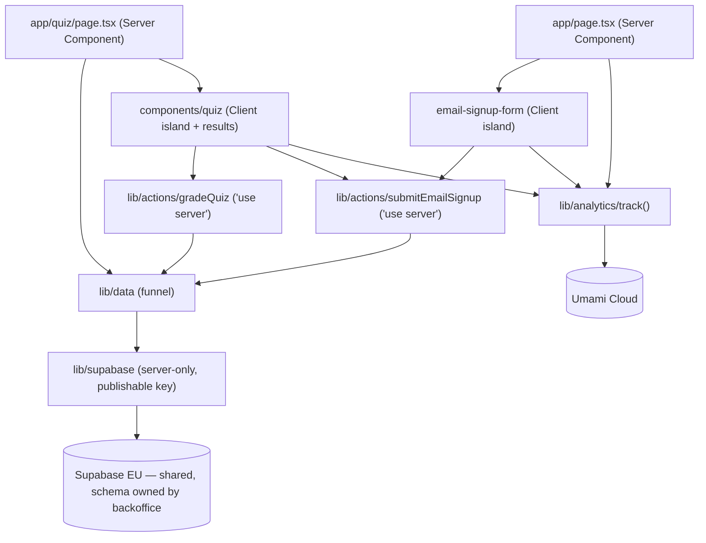
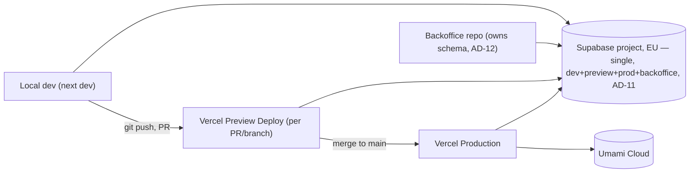

# Architecture Spine — Remindeer — Landing + Quiz di Assaggio

> **Amendment 2026-09-28.** Quiz content moved from repo files to the shared Supabase project owned by the backoffice repo. AD-2, AD-3, AD-5, AD-6 are **superseded** (kept below for history) by AD-12, AD-13, AD-14. The landing writes nothing but mailing-list signups; FR-4 and FR-11 are retired. Contract detail: `specs/spec-remindeer/supabase-content-contract.md`.

## Design Paradigm

**Server-first Islands.** The landing route is a tree of Server Components — no client JS ships for anything that isn't interactive. Interactivity is isolated into Client Component islands (quiz flow with its results screen, email forms). Server Components read quiz content; the browser reaches the backend only through Server Actions (grading, mailing-list signup). Supabase is reached only through named functions in `lib/data/`, and analytics only through one wrapper, so islands and server tree can't drift on how they read data or fire events.

Layers map to directories:

- **Presentation (Server Components)** → `app/`, `components/landing/`
- **Interactive islands (Client Components)** → `components/quiz/`, `components/landing/email-signup-form.tsx`, `components/ui/` form primitives
- **Server Actions** → `lib/actions/` (`gradeQuiz`, `submitEmailSignup`)
- **Data funnel** → `lib/data/` (the only Supabase call sites, AD-14)
- **External service clients** → `lib/supabase/` (server-only, publishable key), `lib/analytics/`

## Invariants & Rules

### AD-1 — Stack and hosting fixed [ADOPTED]

- **Binds:** all
- **Prevents:** re-deciding framework/hosting/DB per feature; drift toward a different stack mid-slice.
- **Rule:** Next.js (App Router) + TypeScript + Tailwind CSS on Vercel; Supabase (Postgres, EU — project runs in West EU/Paris; Paris vs Frankfurt pending spec OQ-12), shared with the backoffice; cookieless analytics on Umami Cloud (decided 2026-09-28). Stripe is out of scope; the Refine backoffice lives in its own repo.

### AD-2 — No mid-quiz server persistence; exactly one completion write [SUPERSEDED 2026-09-28 by AD-13]

- **Binds:** FR-7, FR-11
- **Prevents:** a per-question save call being added later "for safety," which would contradict FR-7's refresh-resets-to-Q1 behavior and create partial-quiz records.
- **Rule:** No network write happens between question 1 and the final screen. Exactly one write happens, on quiz completion, carrying score + optional feedback + optional email + timestamp.

### AD-3 — Static quiz content lives in the repo, not the DB [SUPERSEDED 2026-09-28 by AD-12, AD-14]

- **Binds:** FR-5, FR-6, FR-8, FR-11
- **Prevents:** a component fetching questions from Supabase before the DB migration is a real, planned decision.
- **Rule:** The 10 questions + mnemonics are versioned data files in the repo. No question/mnemonic table exists in Supabase this slice.

### AD-4 — Design tokens and components are fixed by DESIGN.md [ADOPTED]

- **Binds:** all UI
- **Prevents:** this spine re-deciding colors, type, spacing, or component shapes that DESIGN.md already owns.
- **Rule:** DESIGN.md's component inventory (`quiz-card`, `answer-option`, `mnemo-box`, `category-tag`, `button-primary`, etc.) is reused by name wherever that visual role recurs (e.g. the same `quiz-card` component backs FR-5's question, FR-8's results, and FR-2's "Con Remindeer" column) — never re-implemented per surface.

### AD-5 — FR-11 write goes through a Server Action; Supabase credentials never reach the browser [SUPERSEDED 2026-09-28 by AD-13]

- **Binds:** FR-10, FR-11, NFR-3
- **Prevents:** an anon Supabase key shipping in the client bundle; a second, undocumented write path bypassing validation.
- **Rule:** The final-screen form submits to a single Server Action (`lib/actions/submitQuizCompletion.ts`, `'use server'`) that validates input server-side and performs the Supabase insert using the project's server-side secret key (legacy `service_role` JWT or the newer `sb_secret_...` format — Supabase issues one or the other depending on when the project is created; confirm the actual format at provisioning, OQ-5), read only from server-side env, never a `NEXT_PUBLIC_`-prefixed var. RLS on the completions table denies all access except this key. Called via `useActionState` + a `<form action>` (React/Next.js standard form-action pattern) — not an imperative `fetch`/typed-object call from an event handler — so every caller of this action gets the same pending/error/success plumbing.
- **Score integrity:** the action receives the raw list of given answers (question id → selected option), not a pre-computed `score` — the server recomputes the score from `lib/content` before writing, so a tampered client can't submit a false score.
- **Timestamp:** `completedAt` is stamped server-side inside the action (`new Date().toISOString()`), never accepted from the client.

### AD-6 — Quiz content reached only through one accessor module [SUPERSEDED 2026-09-28 by AD-14]

- **Binds:** FR-4, FR-5, FR-8
- **Prevents:** N call sites (landing preview, quiz flow, results summary) each parsing the raw content file differently, each needing a separate edit when content moves to Supabase later.
- **Rule:** All reads of question/mnemonic content go through `lib/content/index.ts` (`getQuestions()`, `getPreviewQuestion()`). No component imports the raw data file directly.

### AD-7 — Quiz flow is one route, state held in memory

- **Binds:** FR-5, FR-6, FR-7
- **Prevents:** a per-question route (`/quiz/[step]`) that would let a refresh resurrect mid-quiz progress via the URL, contradicting FR-7.
- **Rule:** The quiz (question index, locked answers) lives entirely in `useState`/`useReducer` inside the `components/quiz/` island on the single `/quiz` route. No route segment encodes quiz step.

### AD-8 — Server Components by default; client boundary drawn only around interactive islands

- **Binds:** all UI
- **Prevents:** `'use client'` at the top of the whole page, which would ship the entire landing tree as client JS for the sake of two small interactive pieces.
- **Rule:** `app/page.tsx` and everything under `components/landing/` stay Server Components. `'use client'` appears only in interactive islands (`components/quiz/`, email/feedback forms, `components/analytics/`).

### AD-9 — Analytics events fired only through one wrapper

- **Binds:** FR-12
- **Prevents:** the landing page and the quiz island independently choosing different names/props for what should be the same event.
- **Rule:** All tracking calls go through `lib/analytics/track.ts`, against a fixed event list in `lib/analytics/events.ts` (`visit_landing`, `quiz_started`, `quiz_completed`, `quiz_feedback`, `email_signup_landing`, `email_signup_quiz`). No component calls the Umami SDK directly. `quiz_completed` fires only after `gradeQuiz` returns `{ ok: true }` — it is now the sole completion measure (SM-1), since no completion row is stored.

### AD-10 — Design tokens wired as Tailwind theme, not CSS variables

- **Binds:** all UI
- **Prevents:** two parallel token systems (Tailwind config values vs. hand-written CSS custom properties) drifting apart as components are added.
- **Rule:** DESIGN.md's colors/type/spacing/radii are registered under `theme.extend` in the Tailwind v4 config and consumed as ordinary utility classes. No `var(--token)` arbitrary-value usage for values already in the theme.

### AD-11 — Single Supabase project, no dev/prod split this slice (shared with backoffice)

- **Binds:** FR-11, deployment
- **Prevents:** provisioning a second project now for a single write-only, low-risk table — cost/setup not justified at this stage.
- **Rule:** One Supabase project (EU) serves local dev, Vercel Preview deploys, production, and the backoffice alike. Accepted trade-off: Preview-deploy submissions land in the same table as production completions (low volume, low risk for an MVP validation slice) — revisit if Preview traffic starts skewing SM-1/SM-2. Revisit the single-project split itself when the full product (auth, real question bank) lands.

### AD-12 — Backoffice owns the Supabase schema (ADR-004)

- **Binds:** FR-5, FR-8, FR-10, FR-13, deployment
- **Prevents:** two repos pushing migrations to one project and corrupting its migration history; landing code drifting from the real schema.
- **Rule:** The backoffice repo owns every table, policy, RPC and bucket — landing tables included. This repo never creates or pushes migrations (`supabase/migrations/` is history only). Schema changes reach the landing only by regenerating `lib/supabase/database.types.ts` with `supabase gen types typescript --linked`; that file is never hand-edited.

### AD-13 — Landing runs as anon: reads + mailing-list insert only; grading via `check_answer`

- **Binds:** FR-5..FR-10, FR-13, NFR-3
- **Prevents:** a secret key in the landing; the browser learning correct answers; score/feedback rows the landing isn't allowed to write.
- **Rule:** The server-only Supabase client uses the publishable key (phase 1, no login); no secret key exists in the landing env. RLS exposes only `is_free` questions and hides `question_options.is_correct`; every select lists its columns. Correctness is obtained only by the `gradeQuiz` Server Action calling `check_answer` per answer after the last question (a read; `P0002`/`22023` count as wrong). No network call happens between question 1 and the last answer (FR-7). The only write is the mailing-list insert via `submitEmailSignup`, which requires consent. Score and feedback are never stored; feedback is an analytics event.

### AD-14 — Supabase reached only through the `lib/data/` funnel (ADR-003)

- **Binds:** all data access
- **Prevents:** ad-hoc queries scattered across components/actions, each needing edits when the schema changes.
- **Rule:** Named functions in `lib/data/` (`getFreeQuestions`, `checkAnswer`, `getImageUrls`, `insertEmailSignup`) are the only Supabase call sites; they map snake_case rows to client-safe camelCase types (`lib/data/types.ts`). ESLint `no-restricted-syntax` fails the build on `supabase.from`/`rpc`/`storage`/`auth` outside `lib/data/`. Images are served through 1-hour signed URLs from the private `question-images` bucket, generated per `/quiz` request.

**Dependency direction:**



## Consistency Conventions

| Concern | Convention |
| --- | --- |
| Naming (entities, files, interfaces, events) | Components PascalCase, files kebab-case. Analytics event names snake_case, defined once in `lib/analytics/events.ts`. Questions and options keyed by Supabase uuid — options never by `position`. DB columns snake_case; mapped to camelCase only inside `lib/data/`. |
| Data & formats (ids, dates, error shapes, envelopes) | `gradeQuiz` input: `{ questionId: uuid, optionId: uuid }[]`; output `{ ok: true, results: { questionId, isCorrect }[] }` or `{ ok: false, error }`. `submitEmailSignup` takes FormData (`email`, `consent`); output `{ ok: true }` or `{ ok: false, error }`. Actions never throw to the client for expected failures. Question count is dynamic — never hardcoded. |
| State & cross-cutting (mutation, errors, logging, config, auth) | `lib/supabase/`, `lib/data/` and `lib/actions/` are server-only (`server-only` package). Env: `SUPABASE_URL`, `SUPABASE_PUBLISHABLE_KEY` (server env, no `NEXT_PUBLIC_` prefix); no secret key. No auth this slice. AD-14 is lint-enforced; AD-9/AD-10 are review-gated. Validation library is Zod **v4** (`^4.4.3`) — write v4 syntax (`z.uuid()`), not v3 patterns. |

## Stack

| Name | Version |
| --- | --- |
| Next.js (App Router) | 16.2.12 |
| React | 19.2.4 |
| TypeScript | ^5 |
| Tailwind CSS | ^4 |
| @supabase/supabase-js | ^2.111.0 |
| zod (Server Action input validation) | ^4.4.3 |
| server-only | ^0.0.1 |
| Vercel | hosting platform, no pinned version |
| Supabase project | Postgres, EU (West EU/Paris), shared with backoffice; types generated via Supabase CLI |

## Structural Seed

```text
app/
  layout.tsx          # root layout, fonts (Fredoka, Lexend, Inter)
  page.tsx            # landing — Server Component (hero, comparison, email signup, footer)
  quiz/page.tsx       # /quiz — Server Component, loads free questions, renders QuizFlow
  globals.css         # Tailwind entry
components/
  landing/            # hero, comparison, email signup section/form, header, footer
  quiz/               # QuizFlow + ResultsScreen client island (grading, feedback, email)
  ui/                 # shared primitives per DESIGN.md
  analytics/          # page-view tracker
lib/
  data/               # Supabase funnel (AD-14): questions.ts, emailSignup.ts, types.ts
  actions/            # gradeQuiz.ts, submitEmailSignup.ts ('use server')
  supabase/           # server-only client (publishable key) + generated database.types.ts
  analytics/          # track.ts + events.ts
  quiz/               # shuffle helper
supabase/migrations/  # history only — never pushed (AD-12)
```

**Deployment & environments:**



Single Vercel project, platform-default preview-per-PR and production-on-`main` — no custom CI/CD pipeline needed for this slice.

## Capability → Architecture Map

| Capability / Area | Lives in | Governed by |
| --- | --- | --- |
| FR-1, FR-2, FR-3 (hero, comparison, footer) | `components/landing/` | AD-4, AD-8 |
| FR-4 (quiz preview) | retired 2026-09-27 | — |
| FR-5, FR-6, FR-7 (quiz flow) | `app/quiz/`, `components/quiz/`, `lib/data/` | AD-7, AD-8, AD-12, AD-13, AD-14 |
| FR-8 (results + per-question recap) | `components/quiz/results-screen.tsx`, `lib/actions/gradeQuiz.ts` | AD-13, AD-14 |
| FR-9 (feedback) | `components/quiz/results-screen.tsx`, `lib/analytics/` | AD-9, AD-13 |
| FR-10, FR-13 (email signups) | `lib/actions/submitEmailSignup.ts`, `lib/data/emailSignup.ts` | AD-12, AD-13, AD-14 |
| FR-11 (completion write) | retired 2026-09-28 — replaced by `quiz_completed` event | AD-9 |
| FR-12 (cookieless analytics) | `lib/analytics/` | AD-9 |
| NFR-1 (accessibility, no color-only state) | `components/ui/`, results rows (✓/✗ + text) | AD-4 |
| NFR-3 (EU data residency) | `lib/supabase/` | AD-1, AD-11, AD-13 |
| NFR-2 (mobile-first performance) | `components/` (Server-Component-default keeps bundle small, AD-8) | AD-8; no quantitative budget — see Deferred |

## Deferred

Resolved 2026-09-28: OQ-1 (content from backoffice), OQ-4 (Umami Cloud), OQ-6 (`remindeer.it`), content move to Supabase (AD-12..14). Tracked open items live in `specs/spec-remindeer/SPEC.md`.

- **OQ-2** — final logo; PO supplies it, `logo-mark` placeholder until then.
- **OQ-3** — legal pages + consent copy; next step, with Iubenda.
- **OQ-5** — Supabase account ownership (must be PO).
- **OQ-11 (backoffice)** — `email_signups` lacks `source`, consent proof (`consent_given_at`, `consent_text_version`), unique email, anon insert-only policy. Landing inserts email only until then.
- **OQ-12** — Paris vs Frankfurt region.
- **Umami wiring** — script + website id once the PO account exists; `track()` is a no-op until then.
- **Auth / premium questions / cross-device progress** — later phases; no seam reserved.
- **Rate-limiting / spam protection on Server Actions** — not decided; `submitEmailSignup` and `gradeQuiz` are the natural places.
- **NFR-2 quantitative performance budget** — none set; AD-8 judged sufficient.
- **Error monitoring / observability** — none decided; actions log to server console only.
