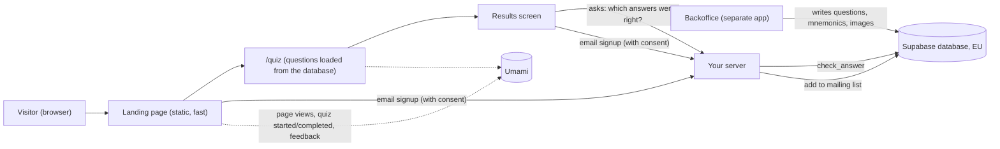
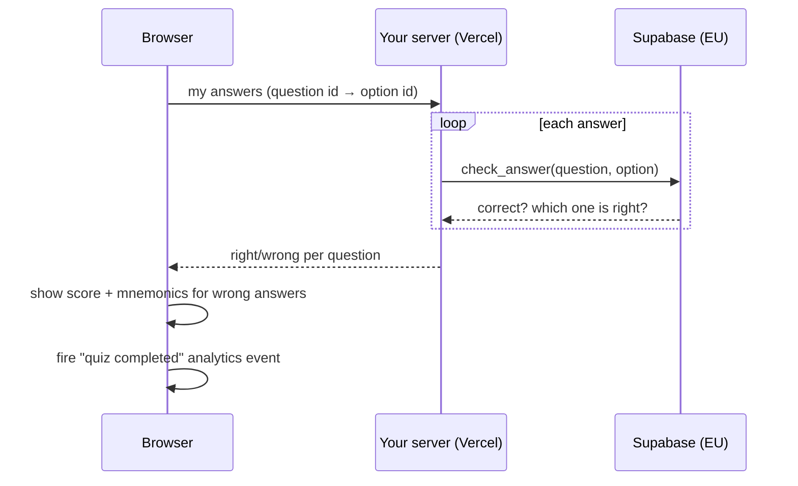

# Remindeer — Landing + Quiz di Assaggio — Solution Design

This document walks through how the first public slice of Remindeer gets built, in plain language. It's a companion to `ARCHITECTURE-SPINE.md`, which is the terse, authoritative version a developer or coding agent works from — this document exists to explain the *why* behind that spine's decisions.

> **Update 2026-09-28.** The quiz no longer ships with questions baked into the code: it reads the free questions from the Supabase database that the backoffice fills. And the landing no longer saves quiz results — it only reads content and adds people to the mailing list. The sections below describe the current design.

## What we're building

A landing page (hero, "why this isn't just another quiz" comparison, email signup, footer) plus a quiz on its own page (`/quiz`) that anyone can try without an account. The quiz shows every question the backoffice marks as free, in official-number order. After the last question, a results screen shows the score, marks each question right or wrong, shows the mnemonic for the ones missed, and offers a star rating and an optional email signup. What it does is defined in `specs/spec-remindeer/SPEC.md`; this document covers how.

## The shape of the system

Four things worth understanding about this shape:

**The backoffice owns the database.** Questions, mnemonics, images, and even the table structure are managed from the backoffice. The landing never changes the database's structure — it only reads what the backoffice publishes. This avoids two apps fighting over the same database.

**The landing page is essentially a static page.** The hero, comparison, and footer are rendered once on the server and shipped as plain HTML — fast on mobile without special work.

**The quiz lives in the visitor's browser until the end.** Answering questions talks to no server; a refresh sends the visitor back to question 1. Only after the last answer does the browser ask the server "which of these were right?".

**The only thing saved is an email, and only with consent.** Scores and star ratings are not stored in the database; they are counted anonymously in the analytics tool. That keeps the landing's permissions minimal: read content, add an email to the mailing list, nothing else.

## How the quiz learns what's correct

The database deliberately hides which option is correct — a visitor inspecting the page can't find the answers. Correctness comes only from the server, after the quiz ends:

Choices worth calling out:

- **No secret key on the site.** The landing uses only the public ("publishable") key, whose powers the database strictly limits: read free questions, check an answer, add an email. Even if that key leaked, it couldn't do more.
- **The browser never decides the score.** It only sends which option was picked; the database says whether it was right.
- **Images stay private.** Question and mnemonic images live in a private storage area; the server hands out links that expire after an hour.

## What's fixed now vs. left open

**Fixed** (see `ARCHITECTURE-SPINE.md`, AD-1 through AD-14):

- Stack: Next.js + TypeScript + Tailwind on Vercel, Supabase in the EU (shared with the backoffice), Umami for cookieless analytics.
- The backoffice owns the database structure; the landing only regenerates its type definitions when that structure changes.
- All database access goes through one folder of named functions (`lib/data/`), enforced by an automatic code check.
- One Supabase project serves development, previews, production, and the backoffice.
- The visual design is owned by `DESIGN.md`.

**Left open**, and why that's fine for now:

- The mailing-list table still lacks a record of when and to which text consent was given, a marker for where the signup came from, and protection against duplicate emails. The backoffice needs to add these before public launch (GDPR).
- The database runs in Paris rather than Frankfurt — still EU; to be confirmed.
- Legal pages and consent wording arrive in the next step, with Iubenda.
- Umami is chosen but not wired until the account exists; the final logo is pending.
- No performance budget, error-tracking tool, or spam protection yet — each has a natural place to be added later without restructuring.

## Why this approach fits the constraints

Budget is tight and the goal is to *measure engagement*, not build the full product. Moving content to the shared database means the PO edits questions in one place (the backoffice) and the landing picks them up with no code change. Shrinking the landing's database permissions to "read + mailing list" is both simpler and safer than the earlier design: no secret key to protect, no score table to maintain. Where rigor matters — correct answers and personal data — it's spent: answers stay server-side, emails need consent, data stays in the EU.
